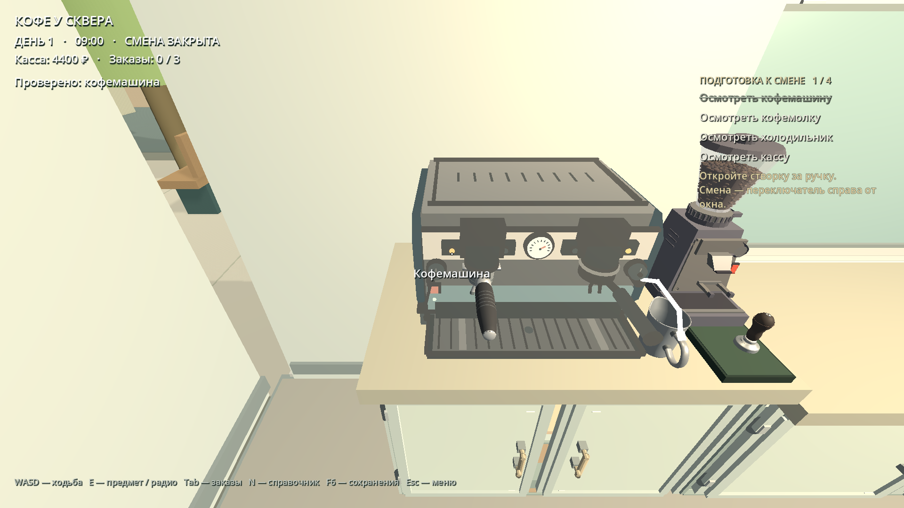

# Coffee Shift — DEV-05: осмотр оборудования и интерфейс задач

Дата: 6 ноября 2026 года. Репозиторий: `valuableprince/coffee-shift-dev` (public).
База: `main`, `02a87c601e90fbd9c5a31141922614361a8c9f71`.
Ветка: `feat/dev05-equipment-inspection`. PR подготовлен для проверки, без слияния.

## Результат

Перед каждой сменой игрок осматривает кофемашину, кофемолку, холодильник и кассу. Наведение показывает `[E] Осмотреть`. Каждый прибор запускает собственную анимацию руки; только её естественное завершение переводит соответствующую проверку в `COMPLETED`. Текст плавно зачёркивается и приглушается. Все выполненные строки сохраняются до окончания подготовки, после четвёртой проверки список плавно исчезает. Успешное закрытие смены сбрасывает все четыре проверки для следующей смены, включая повторное открытие в тот же игровой день.

## Предварительный аудит и причина дефекта

- Авторитетное состояние проверок уже существовало в `CoffeeShiftSession.equipment` и сохранялось в snapshot schema 2. Его не потребовалось заменять.
- `ShiftHUD.refresh()` всегда выводил один статичный абзац «Проверьте…», независимо от значений `equipment`. Поэтому выполненный осмотр визуально оставался незавершённой задачей.
- `prepare_equipment()` повторно принимал уже выполненные проверки и создавал дополнительные checkpoint. Защита от повторов добавлена на уровне сессии.
- `close_shift()` не сбрасывал проверки, поэтому следующие смены обходили подготовку. Сброс теперь происходит только после успешного закрытия и завершения принятых заказов.
- Использованы существующие `ShiftWorkstation`, единственный FPS-raycast, `ShiftFridge`, `ShiftSaveManager`, меню, звуковая система и оригинальные модели оборудования.
- Публичная процедурная модель руки из `FirstPersonTools` вынесена в общий `BaristaHand`; гаражные инструменты используют ту же геометрию. Новых внешних ассетов нет, исходные GLB не изменены.

## Интерфейс

Правая колонка использует `StyleBoxEmpty`: фоновая заливка и рамка удалены. `EquipmentTaskList` показывает четыре независимые строки и счётчик. `EquipmentTaskRow` выводит светлый текст, а завершение за 0,32 с рисует линию поверх букв и приглушает строку. После последней проверки все четыре строки остаются читаемыми 0,9 с, затем исчезают за 0,28 с. После загрузки состояние строк восстанавливается сразу, без повторного проигрывания анимации выполнения.

Список расположен справа выше зоны диалога; проверено отсутствие пересечений с центральной подсказкой, верхним HUD и реальной панелью диалога в обоих разрешениях. Режим растяжения `expand` убирает округление до 1365 пикселей у окна 1366×768. Подсказки следующего шага и выбор оплаченных заказов сохранены.



## Четыре анимации

Отдельные ресурсы `Animation` проигрываются существующим для Godot механизмом `AnimationPlayer`. Ключи управляют выдвижением руки, нажатием, хватом, коротким движением осмотра и дверцей. Контакты заданы в локальных координатах реальных моделей и преобразуются в мировые; рука холодильника следует движущейся ручке. Сохраняется обычная проверка глубины, рука не рисуется поверх геометрии.

| Прибор | Длительность | Действие и звук | Реальный кадр |
| --- | --- | --- | --- |
| Кофемашина | 1,12 с | Рука тянется к штатному выключателю, указательный палец нажимает кнопку; существующий `machine` | [PNG](screenshots/animation-machine.png) |
| Кофемолка | 1,24 с | Рука касается бункера и выполняет короткий осмотр; существующий `paper` | [PNG](screenshots/animation-grinder.png) |
| Холодильник | 1,50 с | Хват ручки, открытие до 60°, осмотр содержимого, закрытие; существующий `window` | [PNG](screenshots/animation-fridge.png) |
| Касса | 1,18 с | Два нажатия клавиш без оплаты и открытия ящика; существующий `cash` | [PNG](screenshots/animation-cash.png) |

Обычная дверца холодильника по-прежнему открывается на 105°. Осмотр уже открытого холодильника сохраняет его исходный угол до закрытия; отмена возвращает исходное состояние дверцы. Касса после проверки снова открывает денежный ящик по E; холодильник снова предоставляет молоко через штатную дверцу. Кофемашина и кофемолка сохраняют рабочие действия рецептов.

## Транзакция осмотра, управление и сохранения

- На время клипа блокируются движение, обзор и повторное взаимодействие, включая попытку перейти к другому прибору.
- Повторное завершение одной задачи отвергается в `CoffeeShiftSession`, без повторной записи прогресса.
- Esc, F6, потеря фокуса, загрузка, смена сцены и остановка клипа отменяют незавершённый осмотр. После отмены задача остаётся `PENDING`; меню сохраняет собственную блокировку управления до возврата в игру.
- В save попадают только уже завершённые проверки. Движение дверцы и незавершённый клип не сериализуются; при сохранении во время осмотра холодильника сохраняется его исходное состояние.
- Используется существующий формат schema 2. Проверены ручное сохранение после двух приборов, загрузка в текущей и совершенно новой сцене, и загрузка во время анимации.
- Открытие смены остаётся штатной операцией и требует четырёх завершённых проверок, открытого окна и доступных ингредиентов. Расчёты, рецепты, выдача и история смен используют прежнюю бизнес-логику.

## Проверки

Среда: Godot **4.3.stable.official.77dcf97d8**, Linux; реальный GL Compatibility, Mesa llvmpipe. Проверки выполнялись физическими событиями E, реальными raycast, естественным временем `AnimationPlayer`, существующими кнопками UI и записью файлов сохранений. Фикстуры задают профиль покупателя и его рецепт; результаты операций не подставляются напрямую.

- `tests/dev05_inspection.gd`: **239 проверок headless, 0 сбоев**.
- Тот же сценарий с реальным рендерингом и сохранением кадров: **269 проверок, 0 сбоев**. Включены точные размеры PNG, расположение HUD, обе смены, оплата/эспрессо/выдача, четыре отмены и свежая сцена после загрузки.
- Полный `tools/ci/audio01_local.sh`: **PASS** — проверены 15 аудиофайлов, импорт, AUDIO-01 smoke, запуск обеих сцен, радио и интеграция новых ассетов в GL. Ошибок скриптов, импорта и анимаций в этом прогоне нет.
- 20 выбранных headless/startup сценариев проходят; подробные логи находятся в архиве evidence. В таблице ниже повторные прогоны не суммируются.

| Сценарий | Итог |
| --- | --- |
| `asset_integration.gd` | 322 проверок, 0 сбоев |
| `career_transactions.gd` | 231 проверок, 0 сбоев |
| `dev01_smoke.gd` | 58 проверок, 0 сбоев |
| `dev02_state.gd` | 63 проверок, 0 сбоев |
| `dev03_domain.gd` | 773 проверок, 0 сбоев |
| `dev03_feedback.gd` | 147 проверок, 0 сбоев |
| `dev03_integration.gd` | 301 проверок, 0 сбоев |
| `dev03_lifecycle.gd` | 44 проверок, 0 сбоев |
| `dev03_persistence.gd` | 45 проверок, 0 сбоев |
| `dev03_polish.gd` | 37 проверок, 0 сбоев |
| `dev03_sink_dialogue.gd` | 46 проверок, 0 сбоев |
| `dev03_startup.gd` | пройден |
| `dev04_integration.gd` | 44 проверок, 0 сбоев |
| `dev05_inspection.gd` | 239 проверок, 0 сбоев |
| `espresso_integration.gd` | 96 проверок, 0 сбоев |
| `grinder_interaction.gd` | 195 проверок, 0 сбоев |
| `new_assets_integration.gd` | 444 проверок, 0 сбоев |
| `prototype_music_smoke.gd` | пройден |
| `radio01_integration.gd` | 52 проверок, 0 сбоев |
| `trailer_integration.gd` | 115 проверок, 0 сбоев |

Всего в сценариях с числовым счётчиком: **3252 проверок**, плюс music/startup smoke. Это включает DEV-05 headless; GL-прогон приведён отдельно.

Некоторые старые проверки адаптированы к утверждённой новой семантике: первый E осматривает прибор, следующий E открывает уже проверенную дверцу/ящик. Тест шагов учитывает документированное отсутствие необязательного пятого concrete OGG в публичной копии, без добавления приватного файла. `dev03_startup.gd` выполнен без `--test-mode`, как требует сам сценарий.

В Godot 4.3 headless существующие 3D-сцены могут выводить `mesh_get_surface_count(m=null)` от dummy renderer. Поэтому дополнительно выполнен настоящий GL-прогон без этих диагностик; это различие уже описано в существующем AUDIO-01 CI. CI DEV-05 проверяет код возврата, ошибки GDScript и обязательную итоговую строку с нулём сбоев.

## Скриншоты и воспроизведение

Все изображения — сохранённые кадры настоящего viewport Godot. Концепт-арты, ImageGen и постановочные замены интерфейса не использовались.

- [HUD 1920×1080](screenshots/hud-pending-1920.png)
- [HUD 1366×768](screenshots/hud-pending-1366.png)
- [Одна выполненная проверка](screenshots/hud-one-completed.png)
- [Список свёрнут](screenshots/hud-collapsed.png)
- Четыре анимации — ссылки в таблице выше. В полном evidence также есть диалоги, состояние 4/4 и подготовка следующей смены.

```bash
Godot_v4.3-stable_linux.x86_64 --headless --path . --editor --import --quit
Godot_v4.3-stable_linux.x86_64 --headless --path . --script tests/dev05_inspection.gd -- --test-mode
Godot_v4.3-stable_linux.x86_64 --audio-driver Dummy --rendering-method gl_compatibility --path . --script tests/dev05_inspection.gd -- --test-mode --screenshots=/absolute/output/path
```

В CI добавлен обязательный DEV-05 сценарий к существующему workflow. Для Windows можно использовать ту же команду с исполняемым файлом Godot для Windows и обычным графическим запуском.

## Границы приёмки и публичность

Нативный запуск на Windows и оценка удобства движений самим игроком остаются для проверки PR. Локальная проверка выполнена в Godot на Linux; она не объявляется Windows playtest. Код подготовки рассчитан на штатные поверхности и планировку существующего трейлера; при перестановке моделей контактные точки нужно согласовать с новой геометрией.

Работа выполнена только из публичной копии. Закрытый GDD, приватная история разработки, неопубликованные звуки/модели и файлы старого репозитория не переносились. В PR входят код, четыре новых оригинальных Animation-ресурса, тесты, этот отчёт и кадры публичной игровой сцены.
