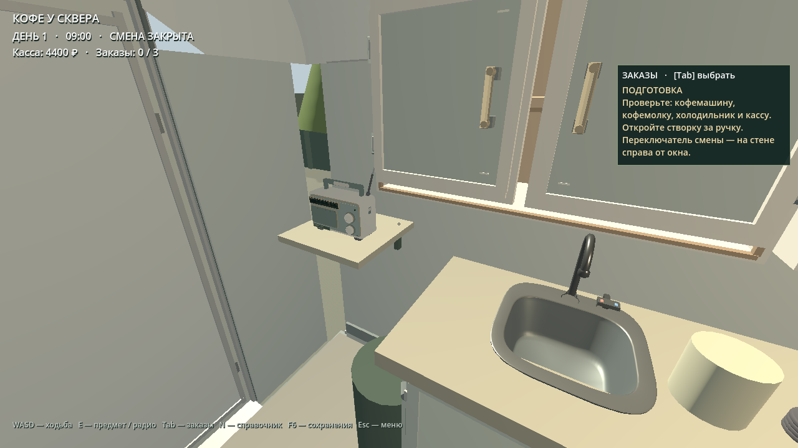
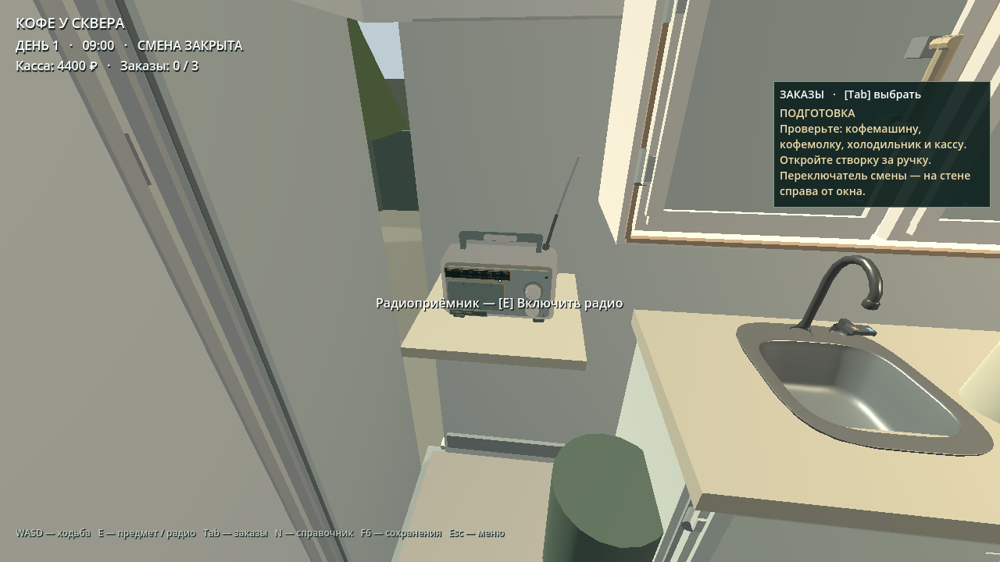
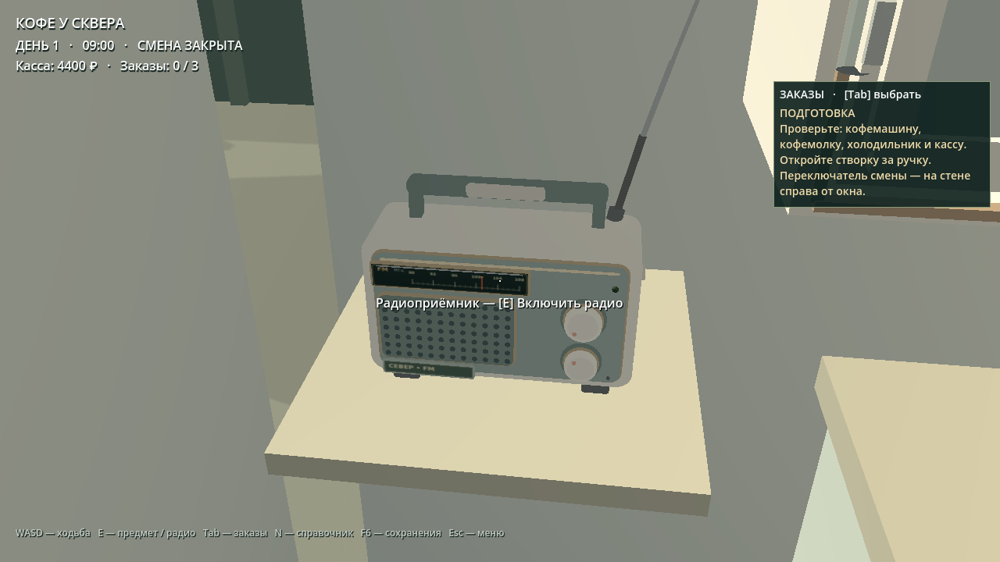

# Coffee Shift — RADIO-01

Радиоприёмник «СЕВЕР FM» установлен на отдельной полке у задней левой стены трейлера. Игрок наводит общий прицел на корпус и нажимает E: музыка и мягкий зелёный индикатор включаются; повторное E выключает звук. Регулятор громкости поворачивается вокруг оси исходной модели.

## Реализация

- Используется оригинальная сцена `assets/models/radio_receiver/radio_receiver.tscn` и исходный GLB в масштабе 1:1. SHA-256 GLB: `204d6569d7c22ed68c738eb1a24e3fa0a3d87f82815180d630ac878e8db883b0`.
- Положение задаётся узлом `Trailer/RadioMount`: `(-0.88, 1.43, 2.30)` м, разворот +90° вокруг Y. Лицевая панель направлена в проход. Ножки опираются на полку; антенна, мойка, кофейное оборудование и навесной шкаф не пересекаются.
- Коллизия исходной сцены подключена к `ShiftWorkstation`. Используются существующий луч игрока и общая кнопка E. Отдельного музыкального менеджера нет.
- `Audio01Director` использует единственный `RadioSound` из модели, шины Radio → Music → Master и существующий разрешённый каталог AUDIO-01. Обратная зависимость громкости от расстояния: `unit_size = 1.5`, `max_distance = 8` м.
- При входе в торговую сцену оба глобальных музыкальных проигрывателя останавливаются до включения пространственного радио, исключая наложение одинаковых музыкальных источников.
- OFF полностью заглушает шину Radio. Внутренняя временная шкала эфира продолжает идти согласно AUDIO-01. Повторное включение использует тот же проигрыватель и текущий эфир.
- Состояние сохраняется существующим полем `world.audio.radio_on`; схема сохранения не меняется. Отсутствующее поле означает OFF. Загрузка синхронизирует звук, индикатор и регулятор.
- При недоступном треке менеджер перебирает остальные разрешённые файлы. Если ни один не доступен, выдаёт предупреждение и оставляет радио безопасно без звука.
- Музыкальные файлы, их лицензии и исходная геометрия радиоприёмника сохранены. Устаревшая подсказка M/P в торговом HUD заменена указанием E для радио.

## T01–T10

Проверки выполнялись официальным Godot 4.3 (`77dcf97d8`), с настоящим GL Compatibility рендерером Mesa/llvmpipe. Проверки состояния проигрывателя дополнены отдельной записью системного аудиовыхода PulseAudio.

| ID | Результат | Доказательство |
|---|---|---|
| T01 | PASS | Запуск торговой сцены, новой карьеры и обеих основных сцен без ошибок выполнения. |
| T02 | PASS | Оригинальный GLB, масштаб, направление, опора и отсутствие пересечений; несколько реальных ракурсов. |
| T03 | PASS | Общий луч находит корпус; при наведении появляется «Включить радио». |
| T04 | PASS | E включает единственный AudioStreamPlayer3D, шину Radio и зелёный индикатор; подсказка меняется на «Выключить радио». |
| T05 | PASS | Повторное E выключает индикатор и полностью заглушает выход Radio; в системной записи OFF содержит нулевые PCM-сэмплы. |
| T06 | PASS | Несколько циклов E и повторный attach сохраняют один эмиттер. В записи повторное ON возвращает музыку без роста уровня. |
| T07 | PASS | Системная запись: рядом −44.24 dBFS RMS, снаружи −65.92 dBFS RMS; разница около 21.7 дБ. |
| T08 | PASS | Запись/чтение настоящего файла карьеры и загрузка в новый экземпляр сцены восстанавливают ON и воспроизведение. Старые сохранения дают OFF; неверный тип отклоняется. |
| T09 | PASS | Инъекция двух отсутствующих путей даёт безопасную тишину; добавление разрешённого трека восстанавливает эфир. Исходные файлы при тесте не удаляются. |
| T10 | PASS | Физическое E у кофемашины, кофемолки, холодильника и кассы; отдельный полный регрессионный сценарий готовит и выдаёт латте с оплатой, сохранениями и исходными ассетами. |

`tests/radio01_integration.gd`: 49 проверок без ошибок; при сохранении четырёх PNG выполняются ещё 8 проверок скриншотов. `tests/audio01_smoke.gd`: 259 проверок без ошибок. Полная интеграция оборудования: 441 проверка без ошибок. Доменные проверки: 773; транзакции карьеры: 231; обе исходные процедурные мелодии также проверены.

Ручная проверка: обычная сцена запущена через F6 в редакторе Godot 4.3; затем в интерактивном режиме той же торговой сцены кнопкой E вручную проверены OFF → ON → OFF, обе подсказки и индикатор. В Output — 0 ошибок выполнения. Debugger показывает 15 жёлтых предупреждений: V-Sync среды и существующие статические предупреждения GDScript (целочисленное деление, затенение имён, типы условного выражения и переменная grid); красных ошибок нет.

Общий тестовый ввод синхронизирован с обработкой событий: `flush_buffered_events()` и ожидание кадра исключают отложенную доставку E после изменения ракурса. Полный тест оборудования использует автономный публичный fixture с SHA-256 11 исходных GLB из базовой main (`e4ae39740cb2bfe3efa22e00109fc3808fbad11c`).

## Проверка звука

`radio01-system-output.wav` — запись **системного monitor-выхода PulseAudio**, 48 кГц, PCM16, стерео, 33.07 с. Это отдельная проверка с реальным драйвером PulseAudio; Dummy и headless не использовались для подтверждения слышимого сигнала. Файл входит в итоговый комплект доказательств.

Последовательность в записи: OFF → ON рядом → ON снаружи → OFF → повторное ON рядом → OFF. Внешний слушатель находится примерно в 4.9 м от динамика; ближний — примерно в 1 м. Для сравнения использованы одинаковые фрагменты уже разрешённого `radio_01_jazz_improv.ogg`. Измеренные интервалы находятся внутри устойчивых фаз; временные метки производителя звука и monitor-записи имеют смещение из-за буферизации PulseAudio.

| Интервал WAV, с | Состояние | RMS |
|---|---|---|
| 0.4–1.8 | OFF | Нулевые сэмплы |
| 4–8 | ON рядом | −44.24 dBFS |
| 12–16 | ON снаружи | −65.92 dBFS |
| 19–20.5 | OFF | Нулевые сэмплы |
| 23–27 | Повторное ON рядом | −44.34 dBFS |
| 31–32.5 | OFF | Нулевые сэмплы |

## Скриншоты из работающего Godot








## CI и воспроизведение проверок

Существующий workflow AUDIO-01 запускает `tools/ci/audio01_local.sh`. Он проверяет исходные аудиофайлы, импорт Godot 4.3, AUDIO-01, запуск обеих сцен, RADIO-01 и полный сценарий оборудования `new_assets_integration.gd`. Перед освобождением тестовых сцен и fault-проигрывателя тест ожидает обработку stop() звуковым микшером, предотвращая утечку playback-ресурсов при быстром завершении CI. Контроль ошибок выполнения включён; CI не отключён. Финальные статусы GitHub Actions и SHA слияния указаны в PR и итоговом комплекте доказательств.

```bash
GODOT_BIN=/path/to/Godot_v4.3-stable_linux.x86_64 bash tools/ci/audio01_local.sh
Godot_v4.3-stable_linux.x86_64 --path . --script tests/radio01_playback.gd -- --test-mode --interactive
```

Во второй команде `--test-mode` изолирует сохранения, а скрипт явно включает реальное воспроизведение AUDIO-01. Для проверки звука следует использовать доступный системный аудиодрайвер.

## Ограничения

- Испытания проведены на Linux в Godot 4.3. Нативный запуск Windows в этой среде не выполнялся.
- Приглушение снаружи обусловлено расстоянием. Акустическое экранирование стенами отдельно не моделируется.
- В редакторе остаются перечисленные выше существующие статические предупреждения GDScript; они не исправлялись в RADIO-01. В fault-тесте T09 ожидаемы предупреждения об отсутствующих ресурсах. Программный OpenGL-драйвер среды выдаёт предупреждение о V-Sync. Это не ошибки игровой логики.
- Ручка настройки станции остаётся декоративной; переключение треков выполняет AUDIO-01.

## Изменённые файлы

- `assets/models/radio_receiver/RADIO_README.md`
- `assets/models/radio_receiver/radio_receiver.tscn`
- `docs/radio01/REPORT.md`
- `docs/radio01/screenshots/01-radio-inside-trailer.png`
- `docs/radio01/screenshots/02-radio-off-prompt.png`
- `docs/radio01/screenshots/03-radio-close-up.png`
- `docs/radio01/screenshots/04-radio-on-indicator.png`
- `scripts/audio/audio01_director.gd`
- `scripts/trade/radio_receiver.gd`
- `scripts/trade/shift_hud.gd`
- `scripts/trade/shift_world.gd`
- `tests/dev03_integration.gd`
- `tests/fixtures/new_assets_sources.json`
- `tests/new_assets_integration.gd`
- `tests/radio01_integration.gd`
- `tests/radio01_missing_audio.gd`
- `tests/radio01_playback.gd`
- `tools/ci/audio01_local.sh`
